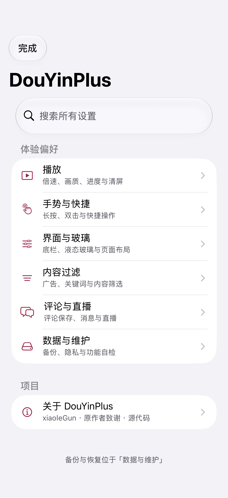
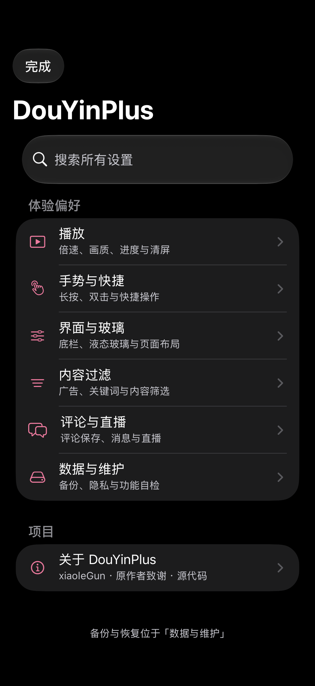
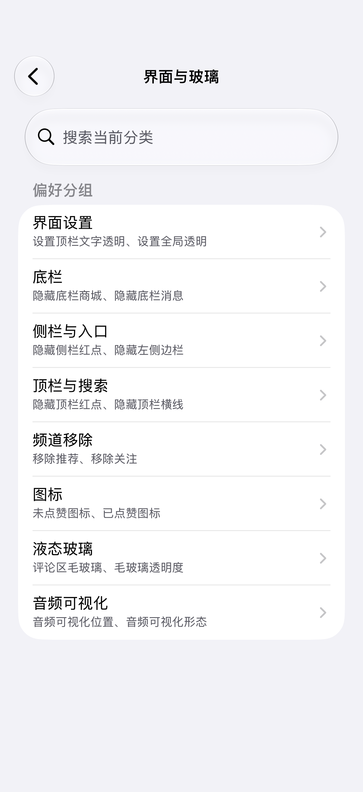
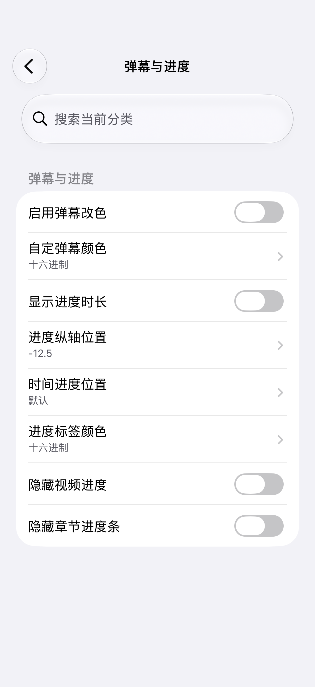
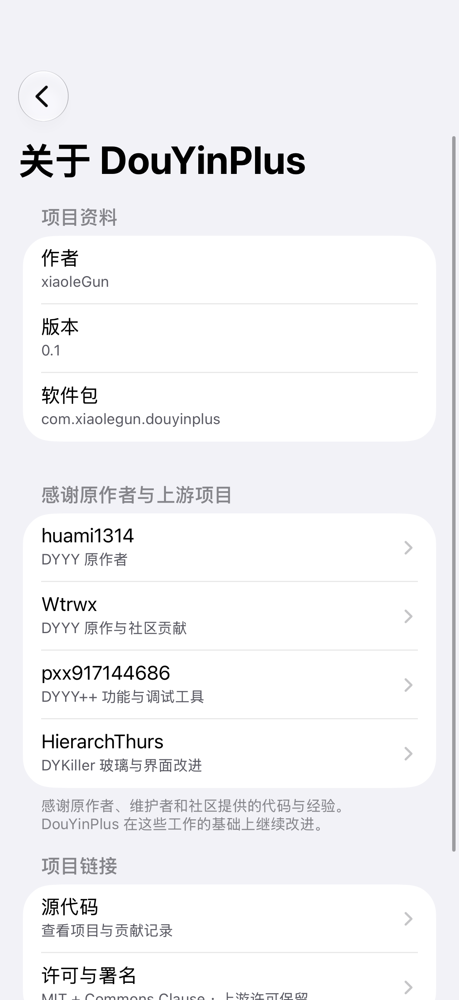
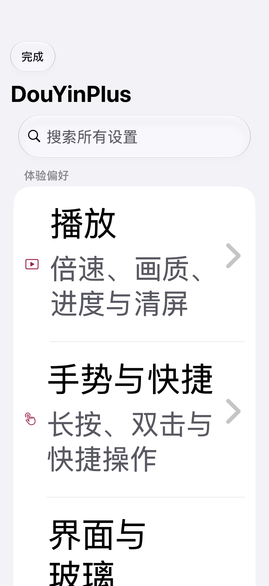

# DouYinPlus

基于 DYYY / DYYY++ 与 DYKiller 的 iOS 抖音体验增强插件，由 **xiaoleGun** 维护。对外名称为 DouYinPlus，内部模块与动态库使用 DYPlus 命名。

**版本 0.1** · **arm64** · **iOS 15+** · **支持 dylib 侧载注入与 Rootless deb 安装**

[界面预览](#界面预览) · [插件功能](#插件功能) · [安装](#安装) · [使用](#使用) · [构建](#构建) · [许可](#许可)

## 界面预览

设置页提供分类、分组导航和全局搜索，支持深色外观与辅助大字体。

<table>
  <tr>
    <th>浅色首页</th>
    <th>深色首页</th>
    <th>分类与分组</th>
  </tr>
  <tr>
    <td></td>
    <td></td>
    <td></td>
  </tr>
  <tr>
    <th>设置表单</th>
    <th>关于与致谢</th>
    <th>辅助大字体</th>
  </tr>
  <tr>
    <td></td>
    <td></td>
    <td></td>
  </tr>
</table>

> 预览仅展示设置界面，实际功能和外观取决于系统及抖音版本。

## 插件功能

- **播放**：倍速、默认清晰度、进度显示与清屏。
- **手势与快捷**：长按、双击、复制、下载和快捷操作。
- **界面与玻璃**：底栏、评论、分享面板与页面布局；保留抖音底栏原文字和图标。
- **内容过滤**：广告、关键词与内容筛选。
- **评论与直播**：评论保存与复制、消息外观和直播布局。
- **数据管理**：设置备份与恢复、插件临时文件清理和 ABTest 配置。

## 安装

### 使用 Feather 侧载

适用于将 `DYPlus.dylib` 注入抖音 IPA 后重新签名安装。Feather 支持 dylib/deb 插件注入，但插件文件本身不是可独立安装的 IPA。[Feather 官方项目](https://github.com/claration/feather)

准备：

- 已安装的 [Feather](https://github.com/claration/feather/releases)。
- 从合法来源取得、可重新签名的未加密抖音 IPA。
- 本项目发布构建生成的 `DYPlus.dylib`。
- 有效的签名证书 `.p12`、密码与匹配的 `.mobileprovision`；描述文件须适用于目标设备和应用标识。证书导入见 [Feather 官方指南](https://github.com/claration/feather/wiki/Using-an-Apple-Developer-Account)。

操作：

1. 在 Feather 的设置中导入证书和描述文件。
2. 将抖音 IPA 导入 Feather 的应用库，打开该应用的签名页面。
3. 在高级选项中进入 **Modify → Tweaks**，点击 **＋** 添加 `DYPlus.dylib`；保留默认注入位置，不勾选 **Inject into Extensions**。中文菜单名称可能随版本变化。[官方注入界面](https://github.com/claration/feather/blob/main/Feather/Views/Signing/SigningTweaksView.swift)
4. 选择有效证书，并确认最终应用标识与描述文件匹配，然后开始签名。
5. 签名完成后，在 Feather 中安装生成的应用。若系统提示开发者信任，按系统提示完成后再打开。
6. 打开侧载的抖音，按下方方法进入 DouYinPlus 设置。

**只注入一套插件**：已有 DYYY、DYYY++ 或旧 DouYinPlus 的 IPA，应先移除旧注入，再加入新库。不建议直接覆盖 App Store 版本；安装前自行备份原应用数据。

证书失效、描述文件不匹配或 IPA 仍受加密保护，均可能导致签名、安装或启动失败。Feather 不保证所有抖音版本及插件组合都兼容。安装问题可参考 [Feather 官方排障](https://github.com/claration/feather/wiki/Troubleshooting)。

### Rootless 越狱环境

安装 `com.xiaolegun.douyinplus_0.1_iphoneos-arm64.deb`，确认环境支持该插件的加载依赖，再重启抖音。deb 的安装位置为 `/var/jb` 下的动态库目录。

软件包显示名为 **DouYinPlus**，包标识为 `com.xiaolegun.douyinplus`。

## 使用

- 在抖音设置中打开 **DouYinPlus**；支持的页面也可通过**双指长按**打开插件设置。
- 按分类查找功能，或使用搜索直接定位设置；部分选项需要重启抖音生效。
- 备份与恢复位于「数据与维护」，修改前建议备份，仅导入可信文件。
- 清理临时文件前，等待下载和媒体合成任务完成。
- Liquid Glass 功能要求真实 **iOS 26+**；其他功能也可能受抖音私有接口变化影响。
- 侧载应用与原应用的账号、数据、通知或登录表现可能不同，取决于签名配置和抖音限制。

内部偏好键和 `Documents/DYYY` 数据目录保持兼容，不需为了更名手动清空。

## 构建

准备 Theos、Logos、Xcode、能够编译 iOS 26 API 的 iOS SDK，以及可用的签名工具。

### 发布版

```sh
export THEOS=/path/to/theos
make DYPLUS_RELEASE=1 package FINALPACKAGE=1 -j4
cp .theos/obj/DYPlus.dylib ./DYPlus.dylib
```

输出：

- `DYPlus.dylib`：用于 Feather 等工具的 IPA 注入。
- `com.xiaolegun.douyinplus_0.1_iphoneos-arm64.deb`：用于 Rootless 越狱环境。

导出时使用 `.theos/obj/DYPlus.dylib`，不要使用 arm64 子目录中的未签名中间产物。Feather 注入后仍需使用自己的有效证书重新签名目标应用。

本机没有 ldid 时，可使用 ad-hoc 签名完成本地构建：

```sh
make DYPLUS_RELEASE=1 package FINALPACKAGE=1 -j4 \
  TARGET_CODESIGN=/usr/bin/codesign \
  'TARGET_CODESIGN_FLAGS=--force --sign -'
```

### 调试版

```sh
make DYPLUS_RELEASE=0 package FINALPACKAGE=1 -j4
```

调试版额外包含 FLEX、Capstone 与逆向助手，体积更大，不建议日常侧载使用。默认构建为发布版；构建产物不纳入源码仓库。

## 许可

本项目中 xiaoleGun 有权许可的新增与修改部分采用 [MIT License + Commons Clause v1.0](LICENSE)。

允许使用、修改与免费分发，但不授予 Commons Clause 所定义的 **Sell** 权利：禁止收费提供价值全部或主要来源于本软件功能的产品或服务，包括条款所涵盖的托管、咨询与支持服务。具体范围以 [Commons Clause 原文](https://commonsclause.com/) 为准；这不是禁止一切商业使用的许可。

上游与第三方代码继续适用原许可；此前有效授予的权利不会被撤销。受限部分属于**源码可见**许可，不是 OSI 认可的开源许可。

## 致谢

保留原作者署名和第三方许可声明，感谢：

- **huami1314** — [DYYY 原作](https://github.com/huami1314/DYYY)
- **Wtrwx** — [DYYY 与社区贡献](https://github.com/Wtrwx/DYYY)
- **pxx917144686** — DYYY++ 功能与调试工具
- **HierarchThurs** — [DYKiller](https://github.com/HierarchThurs/DYKiller) 的液态玻璃与界面改进
- 其他原作者、维护者与社区贡献者。
